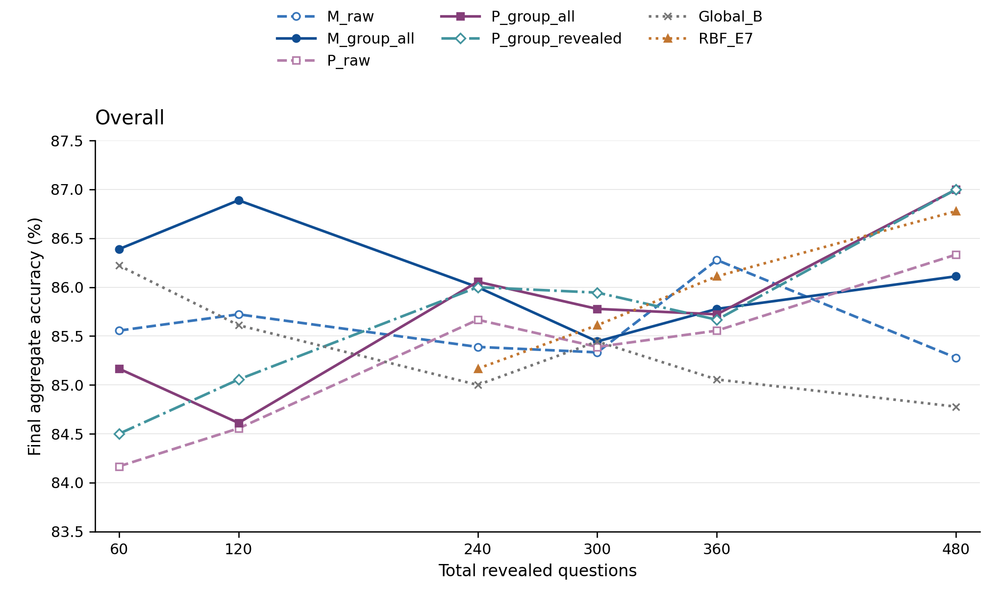
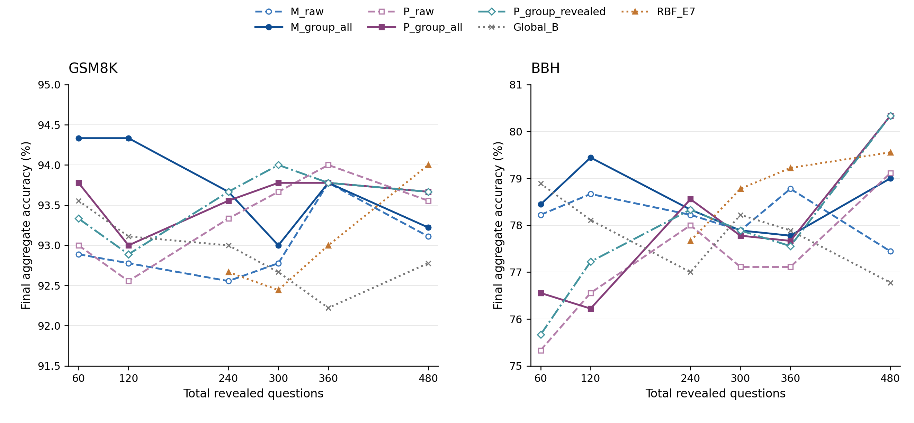

# E12 共享有限反馈的组能力学习

## 核心结论

**满预算 Prefill Group-all 与 Group-revealed 均恢复87.0000%。** MiniLM-Raw恢复85.2778%，Prefill-Raw恢复86.3333%。分数恢复误差在既有容差内，动作与旧端点一致。

**Prefill Group-all 相对同表征Raw在60/120/240题预算分别提高1.0000、0.0556、0.3889个百分点。** 六个既定预算的点差均为正。

**组平滑与全池传播分别呈现不同走势。** Group-revealed相对Prefill-Raw六点均为正，Group-all相对Group-revealed在120和300题下降，在60、240、360题提高，480题相同。全池传播的附加效用取决于预算。

**MiniLM共享监督在低预算更强。** 60/120题下M_group_all为86.3889%/86.8889%，P_group_all为85.1667%/84.6111%。Prefill共享监督在480题端点领先MiniLM 0.8889pp。

**下一步优先改进低预算组–组合能力估计。** 保留MiniLM共享监督强基线，以SaveRouter的同权限收缩估计作为已有方法参照，再为真实部分动作反馈制定固定logger协议。

全部结果属于 `EXPLORATORY_REUSED_TRAIN600`。本轮减少获得完整20×3反馈的训练题数，结果条件于已提供的H480文本、训练组metadata与固定嵌套掩码。

## 预算、权限和固定实现

六预算为累计已揭示原题数60、120、240、300、360、480。每题提供20组合×3已有生成评分。60/120题分别只揭示30/60道GSM8K及30/60道BBH。S240为原I，S300/S360追加原U前60/120题，S480为H。

两个表示均直接复用合法H480拟合的PCA16/Scaler，固定受罚常数列与eta=1000/3。M为原MiniLM，P为原Qwen3-8B第24层完整输入prefill。Raw只拟合S_B原始均值目标；Group-all由当前S_B估计28组能力，再向H480文本传播；Group-revealed使用相同C_B并仅拟合S_B。

H480的task/subtask metadata为各方法共同可用的训练信息。实际选队仅输入题目表征，评价组标签用于汇总。CB仅来自当期揭示奖励，保存的满预算头只在480点复用。所有新增策略和Global_B动作封存后统一评分。

新实现采用85次小矩阵求解，包含10个无奖励T映射与75个受监督求解。60个Group-all头由矩阵乘法派生，15个满预算头复用。Global_B在每个当期S_B重算均值与argmax。

## 全部总体预算曲线

| 总已揭示原题 | M_raw | M_group_all | P_raw | P_group_all | P_group_revealed | Global_B | RBF_E7 |
|---|---:|---:|---:|---:|---:|---:|---:|
| 60 | 85.5556 | 86.3889 | 84.1667 | 85.1667 | 84.5000 | 86.2222 | 未测 |
| 120 | 85.7222 | 86.8889 | 84.5556 | 84.6111 | 85.0556 | 85.6111 | 未测 |
| 240 | 85.3889 | 86.0000 | 85.6667 | 86.0556 | 86.0000 | 85.0000 | 85.1667 |
| 300 | 85.3333 | 85.4444 | 85.3889 | 85.7778 | 85.9444 | 85.4444 | 85.6111 |
| 360 | 86.2778 | 85.7778 | 85.5556 | 85.7222 | 85.6667 | 85.0556 | 86.1111 |
| 480 | 85.2778 | 86.1111 | 86.3333 | 87.0000 | 87.0000 | 84.7778 | 86.7778 |

表内单位为%。RBF仅复用240至480的四个旧策略。其原PCA/带宽及正则方案保留，当前新方法统一使用H480预处理与eta1000/3。

## 五项同预算机制比较

| B | P_group_all−P_raw pp | M_group_all−M_raw pp | P_group_all−M_group_all pp | P_group_revealed−P_raw pp | P_group_all−P_group_revealed pp |
|---|---:|---:|---:|---:|---:|
| 60 | +1.0000 | +0.8333 | -1.2222 | +0.3333 | +0.6667 |
| 120 | +0.0556 | +1.1667 | -2.2778 | +0.5000 | -0.4444 |
| 240 | +0.3889 | +0.6111 | +0.0556 | +0.3333 | +0.0556 |
| 300 | +0.3889 | +0.1111 | +0.3333 | +0.5556 | -0.1667 |
| 360 | +0.1667 | -0.5000 | -0.0556 | +0.1111 | +0.0556 |
| 480 | +0.6667 | +0.8333 | +0.8889 | +0.6667 | +0.0000 |

在相同S_B与相同Hessian下，组均值目标的六个正向点值提供组平滑收益线索。将该监督传播到更多H文本还改变了拟合Hessian及文本权重，其附加效果有正有负。当前结果支持区分这两部分，组内逐题残差的统计性质仍需后续专门验证。

## 相对Global_B及Prefill-Raw的点差

| 方法 | 60 pp | 120 pp | 240 pp | 300 pp | 360 pp | 480 pp |
|---|---:|---:|---:|---:|---:|---:|
| M_raw −Global_B | -0.6667 | +0.1111 | +0.3889 | -0.1111 | +1.2222 | +0.5000 |
| M_group_all −Global_B | +0.1667 | +1.2778 | +1.0000 | +0.0000 | +0.7222 | +1.3333 |
| P_raw −Global_B | -2.0556 | -1.0556 | +0.6667 | -0.0556 | +0.5000 | +1.5556 |
| P_group_all −Global_B | -1.0556 | -1.0000 | +1.0556 | +0.3333 | +0.6667 | +2.2222 |
| P_group_revealed −Global_B | -1.7222 | -0.5556 | +1.0000 | +0.5000 | +0.6111 | +2.2222 |
| Global_B −Global_B | +0.0000 | +0.0000 | +0.0000 | +0.0000 | +0.0000 | +0.0000 |

全部方法相对P_raw的差值、任务/seed/fold及事件交叉统计均在E12_RESULTS.json的 `versus_common_baselines` 中。

Global_B的480题点为84.7778%，旧GlobalFixed为84.9444%。两者计算路径和并列规则记录分别保留。fold0的组合5与15在数学上同为0.8625，当前先求三生成均值再求题均值，得到0.8625000000000002与0.8625000000000004，按预设精确分数argmax选择15。旧实现对原奖励一次mean并用原列序选5。这一近并列数值敏感性影响该默认对照，主比较P_group_all−P_raw继续使用同一冻结模型分数。

## 分任务曲线

### GSM8K

| B | M_raw% | M_group_all% | P_raw% | P_group_all% | P_group_revealed% | Global_B% | RBF_E7% |
|---|---:|---:|---:|---:|---:|---:|---:|
| 60 | 92.8889 | 94.3333 | 93.0000 | 93.7778 | 93.3333 | 93.5556 | 未测 |
| 120 | 92.7778 | 94.3333 | 92.5556 | 93.0000 | 92.8889 | 93.1111 | 未测 |
| 240 | 92.5556 | 93.6667 | 93.3333 | 93.5556 | 93.6667 | 93.0000 | 92.6667 |
| 300 | 92.7778 | 93.0000 | 93.6667 | 93.7778 | 94.0000 | 92.6667 | 92.4444 |
| 360 | 93.7778 | 93.7778 | 94.0000 | 93.7778 | 93.7778 | 92.2222 | 93.0000 |
| 480 | 93.1111 | 93.2222 | 93.5556 | 93.6667 | 93.6667 | 92.7778 | 94.0000 |

### BBH

| B | M_raw% | M_group_all% | P_raw% | P_group_all% | P_group_revealed% | Global_B% | RBF_E7% |
|---|---:|---:|---:|---:|---:|---:|---:|
| 60 | 78.2222 | 78.4444 | 75.3333 | 76.5556 | 75.6667 | 78.8889 | 未测 |
| 120 | 78.6667 | 79.4444 | 76.5556 | 76.2222 | 77.2222 | 78.1111 | 未测 |
| 240 | 78.2222 | 78.3333 | 78.0000 | 78.5556 | 78.3333 | 77.0000 | 77.6667 |
| 300 | 77.8889 | 77.8889 | 77.1111 | 77.7778 | 77.8889 | 78.2222 | 78.7778 |
| 360 | 78.7778 | 77.7778 | 77.1111 | 77.6667 | 77.5556 | 77.8889 | 79.2222 |
| 480 | 77.4444 | 79.0000 | 79.1111 | 80.3333 | 80.3333 | 76.7778 | 79.5556 |

Prefill Group-all在120题预算的GSM8K为93.0000%、BBH为76.2222%；同预算MiniLM Group-all为94.3333%、79.4444%。480题时prefill的BBH升至80.3333%，MiniLM为79.0000%。较强表征的实际收益需随反馈量分别衡量。

## 已有generation与outerfold分解

以下为主比较P_group_all−P_raw，保留全部既定重复。

| B | seed42 pp | seed137 pp | seed2024 pp | fold0 pp | fold1 pp | fold2 pp | fold3 pp | fold4 pp |
|---|---:|---:|---:|---:|---:|---:|---:|---:|
| 60 | +0.6667 | +1.3333 | +1.0000 | -0.5556 | +0.8333 | +0.5556 | +0.2778 | +3.8889 |
| 120 | -0.3333 | +0.3333 | +0.1667 | +0.2778 | -0.8333 | -0.8333 | +0.5556 | +1.1111 |
| 240 | +0.5000 | -0.3333 | +1.0000 | +0.8333 | -0.8333 | -1.1111 | +0.0000 | +3.0556 |
| 300 | +0.3333 | +0.3333 | +0.5000 | +1.1111 | +1.1111 | -0.5556 | +0.0000 | +0.2778 |
| 360 | +0.0000 | +0.5000 | +0.0000 | -0.8333 | -0.2778 | +1.1111 | +0.0000 | +0.8333 |
| 480 | +0.8333 | +1.0000 | +0.1667 | +0.8333 | +1.1111 | +1.1111 | +0.5556 | -0.2778 |

全部六新方法及RBF四点各自的seed、fold、27个BBH子任务结果与支持数完整保存在JSON。三次生成属于同题已有输出，600题为原始问题集合。

## 纠错、破坏与换队

| B | 主比较纠错 | 主比较破坏 | 主比较净事件 | P_group_all相对自身480点换队题数 |
|---|---:|---:|---:|---:|
| 60 | 45 | 27 | +18 | 479 |
| 120 | 31 | 30 | +1 | 463 |
| 240 | 34 | 27 | +7 | 384 |
| 300 | 30 | 23 | +7 | 372 |
| 360 | 32 | 29 | +3 | 315 |
| 480 | 29 | 17 | +12 | 0 |

事件分母为600题×3个已有生成，即1800。各方法相对P_raw、Global_B及各项机制对照的全部交叉计数均在JSON，换队题数以原题计。

## 与强RBF参照的预算效率

| 方法 | 已测格点首次达到86.3333% | 已测格点首次达到86.7778% | 六点AULC% | 共同240–480 AULC% |
|---|---:|---:|---:|---:|
| M_raw | 本次格点未达到 | 本次格点未达到 | 85.6389 | 85.6806 |
| M_group_all | 60 | 120 | 86.1071 | 85.8056 |
| P_raw | 480 | 本次格点未达到 | 85.3532 | 85.7222 |
| P_group_all | 480 | 480 | 85.7063 | 86.0972 |
| P_group_revealed | 480 | 480 | 85.7540 | 86.1111 |
| Global_B | 本次格点未达到 | 本次格点未达到 | 85.2619 | 85.0764 |
| RBF_E7 | 旧四点参考 | 480 | 低预算未测 | 86.0347 |

M_group_all在60题达到86.3889%，在120题达到86.8889%。后者超过旧RBF的480题端点86.7778%，属于已测格点的质量参照。RBF在60/120题的成绩仍为空。

共同240–480区间中，P_group_all面积为86.0972%，P_group_revealed为86.1111%，RBF为86.0347%。RBF在360题为86.1111%，高于P_group_all的85.7222%；480题RBF为86.7778%，P_group_all为87.0000%。完整曲线保留这些交叉。

AULC是实际点直线连接后的归一化面积，旧RBF只计算共同范围。它与每个预算的原始点共同解释。

## 反馈预算与成本

| 总B/gold | 历史成员调用 | 历史聚合调用 | 原始聚合评分 |
|---|---:|---:|---:|
| 60 | 1080 | 3600 | 3600 |
| 120 | 2160 | 7200 | 7200 |
| 240 | 4320 | 14400 | 14400 |
| 300 | 5400 | 18000 | 18000 |
| 360 | 6480 | 21600 | 21600 |
| 480 | 8640 | 28800 | 28800 |

每个预算和外折的这份反馈由所有方法共享。嵌套六点属于累计场景，历史交叉的五折仍共享原train600缓存。共同历史总投入为600 gold、10800成员调用、36000聚合调用。

本次实际完成85次线性求解，CPU记录合计0.000000秒，solve wall合计0.002286100秒。短调用CPU受Windows计时粒度影响，0记录不代表没有计算。训练CPU/wall为0.781250/4.174203秒，评分及成本汇总CPU/wall为2.000000/2.521711秒。命令进程wall为8.984031秒。

本轮新增prefill、成员答案、聚合与gold采购均为0。三类保存的满预算头共复用15个，其中T映射依赖文本和metadata，新增监督求解只由当期合法奖励构造。

COST.json逐外折逐预算记录实际反馈input/output token和source wall，以及各方法在E120上按所选组合形成的服务token足迹。服务账包含三个成员和一次聚合，反馈评分另列，服务scoring_ops为0。服务策略不同会改变token开销，共享同mask使反馈token账一致。

## 表征准备与部署开销

Prefill缓存来自E10完整输入600题，47899输入token、GPU事件间隔合计71.0545秒；模型载入548.3644秒。旧研究额外6个R_match前缀的投资保留为来源背景，本轮只复用full向量。

旧测量中完整输入prefill warm均值约119.322ms，PCA/线性头CPU剖析均值约82.489μs。Group-all与Raw的实际服务架构相同，当前能力共享在训练侧完成。两个组件均值之和为分项估计，联合在线端到端计时与本轮独立服务基准未另执行。

RBF与M系列使用MiniLM表征。原MiniLM CPU重放600题为batch8、模型载入9.9637秒、编码30.0052秒；这与Qwen单题GPU测量的批量和硬件口径不同。RBF还需对已标注样本计算核预测，当前复用已有策略，未另计独立在线延迟。因此保持两类既有成本事实与其口径，当前结果不能给出严格匹配硬件下的延迟倍数。

## 组支持与权限核对

每折60题的BBH支持为24组×1题和3组×2题，120题为21组×2题和6组×3题，240题为15组×4题和12组×5题。GSM各点占原题数一半，全部28组均已覆盖，fallback次数为0。每折每组每预算的原题数保存在 `group_support`。

低预算组能力只由Y[S_B]计算，Group-all利用已提供H480文本和组metadata形成480行伪目标。已揭示原题数仍是B。组metadata的现有可见权限是方法前提，未来对照需共享这项权限。

原E7四点及六点nested masks已逐ID核对，RBF沿用其1e-10近似最高分最小列规则，并按原E索引回填全局位置。保存的满预算A、R_full、R_group均完成分数和动作恢复。

## 文献与方法定位

SaveRouter原文§4和官方源码已实际核查，已有训练分组、稀疏query–model监督、组能力收缩及逐题残差。其当前官方profile与指定v1附录存在部分参数差异，数值复现未在本轮执行。监督获取成本也需要按其原口径和本项目的gold/成员/组合聚合分别解释。

将20个组合视为20个输出动作的迁移属于自然适配。组级路由已有基础，E12的实证角色是同一完整题包反馈的利用方式比较。未来可区别之处在于共享成员执行、非可加最终聚合奖励与组间统计共享的联合成本。完整一手来源映射见 `LITERATURE_AND_POSITIONING.md`。

## 优势与风险

**优势**为六预算完全共享掩码、表征与固定正则、可解析分离平滑和全池传播、恢复三个满预算来源并保留强RBF参照。既有缓存使本轮只需85次小矩阵求解。

**风险**为低预算每BBH组仅1至2题，组能力仍可能不稳定；H480组metadata预先可见是额外结构权限。固定单套嵌套掩码、旧600题多轮开发及五折训练历史重叠限制外推。图中非单调曲线、低预算prefill劣势及RBF较强预算点全部保留。

## 下一步判断

**优先改进低预算组–组合能力估计，并保持MiniLM共享监督强基线。** 组平滑的实际收益线索比全池传播更一致，强prefill的低预算附加价值仍需验证。下一项有针对性的候选可参考SaveRouter的结构收缩，在同权限下比较。

真实部分动作反馈属于后续协议。届时先固定同一logger生成的题目/动作/生成掩码，比较学习器利用同样反馈的能力；单生成观测需按原单位计权，缺失动作的估计规则需事先明确。

E12已完成的结果为完整题包数减少下的曲线。下一阶段的固定logger、结构收缩或部分动作实验尚未执行。
