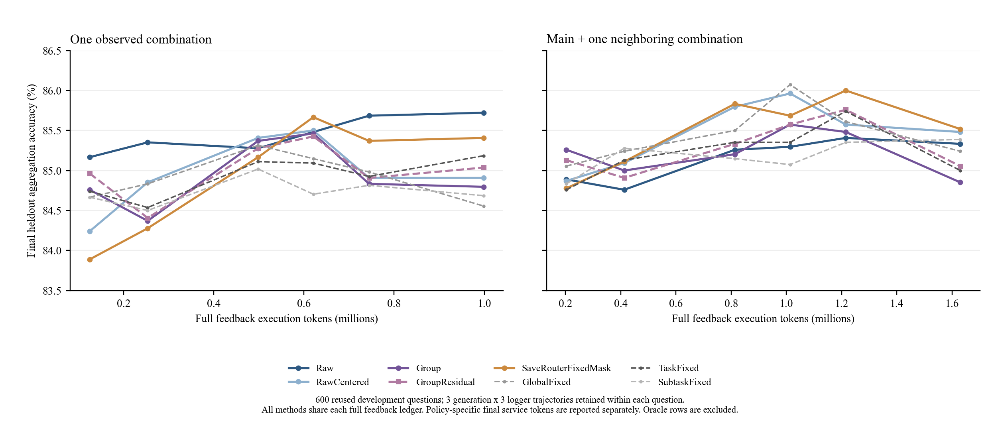

# E13 真正部分组合反馈下的组能力共享

## 研究问题与结论

本轮固定六个冻结模型、每次三个成员、20种组合与V2聚合器，比较同一部分反馈在不同学习器中的利用效果。

**主预算Pair、Gold120未提供组共享独立优于强逐题控制或SaveRouter的统计支持。** Group相对原Raw有正向点值，RawCentered与公开基线仍具有竞争力。全部三个预定主比较的普通95%区间跨零，Holm调整p均为1。

| 预定主比较 | 差值pp | 普通95%配对区间pp | 纠错 | 破坏 | 净事件 | Holm p |
|---|---:|---|---:|---:|---:|---:|
| Group-Raw | +0.2407 | [-0.5556, +1.0741] | 249 | 236 | +13 | 1.000000 |
| Group-RawCentered | -0.0926 | [-0.5370, +0.3333] | 89 | 94 | -5 | 1.000000 |
| GroupResidual-SaveRouterFixedMask | -0.2037 | [-0.8889, +0.5000] | 172 | 183 | -11 | 1.000000 |

## 固定设置与合法反馈

原train600为GSM8K和BBH各300题。沿用五个H480/E120外折，六个累计预算60、120、240、300、360、480。三个固定logger种子17/29/43与成员生成42/137/2024分别记录，形成90条轨迹和540个预算快照。
Main每题购买一个三成员组合的单生成评分。Pair增加一个单成员替换邻居，仍然每次只执行三成员组合。反馈包由题目ID哈希确定，所有方法、各预算及三生成使用相同主动作和邻居，动作选择不读取奖励或实际费用。
模型只接收已购买COO元组。缺失组合没有训练标签行。原600题完整矩阵由缓存管理器和最终评价器持有，E120不参与采购或更新。三生成分别训练、分别评价匹配生成，没有把一次购买转换为三份奖励。
使用旧H480 MiniLM-PCA16与标准化状态，只读取四项预处理数组。旧全反馈拟合权重和旧C480均未进入新学习器。共同硬分组为argmax(Phi T_M)，T_M仅由训练输入和训练组metadata构建。

## 学习器与既定选择

Raw为按动作稀疏Ridge。单生成事件求和目标固定alpha=1000，常数受罚。完整三重复展开除3后恢复E12的1000/3均值尺度，资格检查已通过。
Group固定grand→global-action→task→BBH-subtask收缩，先验伪计数为10/10/3。GSM只使用task层。GroupResidual排除当前整题的所有已购买动作后构造组能力基线，再以相同alpha拟合残差。
RawCentered使用同一已观察全局动作先验加逐题回归，检查原Raw的零先验与观测数收缩是否构成混淆。这里使用既有平方损失和固定分解，没有新增损失搜索。
GlobalFixed、TaskFixed、SubtaskFixed均从当前已观察反馈建立经验组合均值，缺少单元按task/global逐级回退。主任务/子任务固定策略使用共同的输入预测组。两项Oracle额外使用真实查询metadata，单独保留为诊断。
**E13采用共同硬预测组，与E12的线性组监督传播学生不同。** 该选择用于与作者原生SaveRouter预测接口对齐。E12的87%端点和本轮部分反馈绝对成绩之间存在方法与监督单位差异，不能把全部点差都归因于减少标签。

## SaveRouter可追溯适配

官方commit固定为250b7ef35a741c598aaf1bb264930d1e0bfd1a61，原FixedKSparseRouter能力与残差估计器直接运行。LLMRouterBench profile为收缩40、先验Ridge10、残差Ridge200、残差倍率2、最少8个动作观察。主服务按质量argmax，未扫描费用权重或新超参。
本轮将动作映射为20个真实组合，替换为共同fixed-mask logger和共同输入预测组。其费用模型接收已执行组合的独立完整服务Token，采购账仍按成员并集计算。作者类与适配器的分数、成本和模型恢复合成检查通过。
该结果属于SaveRouter-FixedMask的同权限迁移。作者原数据、原获取器与原论文完整在线费用前沿的数值复现属于另一范围。四源码远端字节和本地缓存哈希一致，详细一手来源见LITERATURE_AND_BASELINE_MAPPING.md。

## 主预算完整方法表

| 方法 | 总准确率% | GSM8K% | BBH% | BBH子任务宏平均% | 服务输入权限 |
|---|---:|---:|---:|---:|---|
| Raw | 84.7593 | 92.7778 | 76.7407 | 76.8020 | 共同题目输入 |
| Group | 85.0000 | 92.8519 | 77.1481 | 77.1823 | 共同题目输入 |
| GroupResidual | 84.9074 | 92.7407 | 77.0741 | 77.1075 | 共同题目输入 |
| RawCentered | 85.0926 | 92.9259 | 77.2593 | 77.3039 | 共同题目输入 |
| SaveRouterFixedMask | 85.1111 | 92.7407 | 77.4815 | 77.4972 | 共同题目输入 |
| GlobalFixed | 85.2407 | 93.3333 | 77.1481 | 77.2104 | 共同题目输入 |
| TaskFixed | 85.1296 | 93.8889 | 76.3704 | 76.4372 | 共同题目输入 |
| SubtaskFixed | 85.2778 | 93.8889 | 76.6667 | 76.7459 | 共同题目输入 |
| TaskFixedOracle | 85.3704 | 93.8889 | 76.8519 | 76.9236 | 真实metadata诊断 |
| SubtaskFixedOracle | 85.0926 | 93.8889 | 76.2963 | 76.3749 | 真实metadata诊断 |

## 全部预算曲线

### Main

| Gold | Raw | RawCentered | Group | GroupResidual | SaveRouter | GlobalFixed | TaskFixed | SubtaskFixed |
|---:|---:|---:|---:|---:|---:|---:|---:|---:|
| 60 | 85.1667 | 84.2407 | 84.7593 | 84.9630 | 83.8889 | 84.6667 | 84.7407 | 84.6667 |
| 120 | 85.3519 | 84.8519 | 84.3704 | 84.4074 | 84.2778 | 84.8333 | 84.5370 | 84.5000 |
| 240 | 85.2778 | 85.4074 | 85.3704 | 85.2778 | 85.1667 | 85.3148 | 85.1111 | 85.0185 |
| 300 | 85.4815 | 85.5000 | 85.4630 | 85.4259 | 85.6667 | 85.1481 | 85.0926 | 84.7037 |
| 360 | 85.6852 | 84.9074 | 84.8333 | 84.9074 | 85.3704 | 84.9815 | 84.9259 | 84.8148 |
| 480 | 85.7222 | 84.9074 | 84.7963 | 85.0370 | 85.4074 | 84.5556 | 85.1852 | 84.6852 |
### Pair

| Gold | Raw | RawCentered | Group | GroupResidual | SaveRouter | GlobalFixed | TaskFixed | SubtaskFixed |
|---:|---:|---:|---:|---:|---:|---:|---:|---:|
| 60 | 84.8889 | 84.8704 | 85.2593 | 85.1296 | 84.7778 | 85.0556 | 84.7593 | 84.8333 |
| 120 | 84.7593 | 85.0926 | 85.0000 | 84.9074 | 85.1111 | 85.2407 | 85.1296 | 85.2778 |
| 240 | 85.2593 | 85.7963 | 85.2037 | 85.3333 | 85.8333 | 85.5000 | 85.3519 | 85.1481 |
| 300 | 85.2963 | 85.9630 | 85.5741 | 85.5741 | 85.6852 | 86.0741 | 85.3519 | 85.0741 |
| 360 | 85.4074 | 85.5741 | 85.4815 | 85.7593 | 86.0000 | 85.6111 | 85.7407 | 85.3519 |
| 480 | 85.3333 | 85.4815 | 84.8519 | 85.0556 | 85.5185 | 85.2407 | 85.0000 | 85.3889 |

表中单位均为%。Main与Pair的Group−RawCentered仅B60为正，其余五个预算点为负。Pair中Group−Raw有4/6正向点值，480点仍为负。GroupResidual相对Group的收益方向随预算变化。保留这些交叉，不能由主格点负结果推出任何组方法均无效。

## 生成、logger与外折方向

| 主比较 | seed42 pp | seed137 pp | seed2024 pp | logger17 pp | logger29 pp | logger43 pp |
|---|---:|---:|---:|---:|---:|---:|
| Group-Raw | +0.2222 | -0.2778 | +0.7778 | -0.2222 | +0.6667 | +0.2778 |
| Group-RawCentered | +0.0000 | -0.5556 | +0.2778 | -0.6667 | +0.2222 | +0.1667 |
| GroupResidual-SaveRouterFixedMask | +0.1111 | -0.6667 | -0.0556 | +0.3889 | -0.2778 | -0.7222 |

每个方法在每个预算有600个独立原题和5400个已记录生成×logger事件。所有27子任务、五外折、完整事件交叉及动作频率均在E13_RESULTS.json和E13_SUMMARY.csv。三项主比较按原题簇bootstrap5000次并统一Holm3。普通区间和调整p分别标注，训练历史重叠与已拟合模型条件性继续保留。

## 完整反馈执行成本

| 场景 | Gold | 成员生成 | 组合聚合 | 评分 | 平均实际反馈Token | Token最小–最大 |
|---|---:|---:|---:|---:|---:|---|
| Main | 60 | 180 | 60 | 60 | 124990.64 | 111497–134205 |
| Main | 120 | 360 | 120 | 120 | 253572.53 | 236300–275495 |
| Main | 240 | 720 | 240 | 240 | 498519.78 | 472988–531049 |
| Main | 300 | 900 | 300 | 300 | 620837.24 | 588241–655084 |
| Main | 360 | 1080 | 360 | 360 | 744438.20 | 705917–788070 |
| Main | 480 | 1440 | 480 | 480 | 998474.69 | 944255–1059102 |
| Pair | 60 | 240 | 120 | 120 | 202855.09 | 186635–216464 |
| Pair | 120 | 480 | 240 | 240 | 412422.33 | 392842–439601 |
| Pair | 240 | 960 | 480 | 480 | 813250.00 | 779474–861185 |
| Pair | 300 | 1200 | 600 | 600 | 1013391.49 | 971499–1066291 |
| Pair | 360 | 1440 | 720 | 720 | 1215219.73 | 1167577–1276941 |
| Pair | 480 | 1920 | 960 | 960 | 1630090.53 | 1568865–1727250 |

主Pair120单生成轨迹平均完整反馈为120 gold、480成员、240聚合、240评分、412422.33Token。表内分布覆盖45个外折×logger×生成路径。每个学习器完整共享这一账，采购费只记一次。
不复用共同成员的账本反事实平均为507594.11Token，合法复用节省95171.78Token，约18.75%。该项是所有方法共同拥有的执行权限。
三个生成轨迹若作为一组实际执行，Gold按canonical/reference版本并集仍为B，Main成员/聚合为9B/3B，Pair为12B/6B。Pair120对应1440成员、720聚合、720评分和120 gold。三个模型仍各自只接受其生成轨迹的反馈。
六个预算是嵌套累计场景，五个外折历史重叠，三个logger也是重复方案。COST.json分别保存每路径、跨生成并集与费用分布，不能将这些累计账相加视为新采购。参考版本为固定V2缓存标签，未将其冒称为Gold内容哈希。

## 服务与总执行Token

同预算、同mask的完整反馈成本相同。各方法在E120选择不同组合，最终服务Token可能不同。下表将一份B120反馈采购与120题服务推理按相同世界口径合计。

| 主Pair120方法 | 共同反馈Token | 120题服务Token | 两项合计Token |
|---|---:|---:|---:|
| Raw | 412422.33 | 248408.87 | 660831.20 |
| Group | 412422.33 | 257291.58 | 669713.91 |
| GroupResidual | 412422.33 | 257226.22 | 669648.56 |
| RawCentered | 412422.33 | 255874.27 | 668296.60 |
| SaveRouterFixedMask | 412422.33 | 257854.76 | 670277.09 |
| GlobalFixed | 412422.33 | 247556.53 | 659978.87 |
| TaskFixed | 412422.33 | 254872.78 | 667295.11 |
| SubtaskFixed | 412422.33 | 246562.18 | 658984.51 |

服务列包含所选三成员与一次聚合，推理本身的gold/评分为0。共同研究评测参考答案与完整历史缓存投入另列。服务表由九条600题轨迹的原调用账，除以五折得到平均120题世界。FEEDBACK_AND_SERVICE_COSTS.csv保留所有方法与预算。
题目编码器的既有缓存属于共同输入准备，当前没有重新提取表征。CPU组件另列，未新测各方法独立端到端部署延迟。GlobalFixed实际可以省去编码步骤，当前Token表只比较语言模型执行。源调用wall之和保持历史代理口径，当前GPUelapsed为未测。

## 支持量与失效原因边界

共同组映射的外折组识别率为85.00%。这一指标描述组识别，不等于组合选择准确率。
| Gold | Main已观察组–组合单元比例% | Pair已观察组–组合单元比例% |
|---:|---:|---:|
| 60 | 8.15 | 14.01 |
| 120 | 13.69 | 23.68 |
| 240 | 23.25 | 39.44 |
| 300 | 27.64 | 45.88 |
| 360 | 31.45 | 51.87 |
| 480 | 38.96 | 62.12 |

28组×20组合共有560个组–组合单元。缺失单元依靠已声明的观测统计先验，未填入零奖励。覆盖不足、有限组识别误差、固定收缩强度和有限表示均是可能的限制，当前对照没有识别唯一因果原因。
RawCentered使得零先验/观测数收缩的影响可单独观察。Group未超过它的主点值，因而Group相对原Raw的小幅改善不足以归因为任务组共享的独立价值。残差也未稳定超过既有公开基线。

## 优势、风险与研究决定

**优势**是相同稀疏反馈、完整共享执行账、奖励无关logger、单生成单位及原生公开估计器迁移。对成本的比较没有免费读出其他18或19个组合的评分。
**风险**是旧600题反复开发、各外折训练池重叠、每题每轨迹仅1/2动作，hard分组与有限固定profile。SaveRouter保留作者profile，未在当前任务调参，这个迁移结果不能代表其所有可调配置的性能上限。
**本轮假说尚未得到支持。** 当前可保留SaveRouter-FixedMask与RawCentered作为真正部分反馈的强参照。下一优先任务是定位低支持组–组合单元估计与输入分组误差各自造成的决策损失，再决定是否有必要改变固定logger的覆盖设计。当前不扩展新损失或主动获取网格。

## 实际计算与交付

实际完成540个快照拟合，含1个机制预检并复用于正式训练。自己的三个Ridge右端共享10731次小矩阵求解，对应32193个RHS目标。SaveRouter完成540个原生先验拟合和8331个残差模型拟合。
正式编排wall为147.297秒。拟合、logger/更新、缓存读取、资格和统计CPU分别保留，嵌套计时与并行wall不相加伪装总耗时。新增LLM/API、成员推理、聚合、Gold采购和保留集载荷读取均为0。
私有观察、模型、逐题预测、合法访问日志、实际费用及冻结哈希位于private。公开协议、完整结果、成本、源码和复现入口位于public。MAB工作区没有本地Git检出，本轮交付采用实际文件哈希和来源版本，未虚构新的仓库commit。
