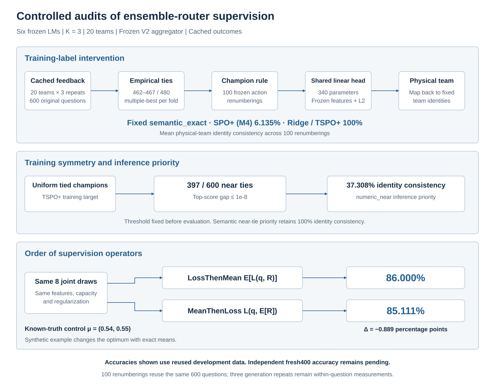

# E18机制理论报告

## 研究问题

工作题目沿用 *When Ties Become Preferences: Auditing Supervision for LLM Ensemble Routing*。本轮将任意冠军约定、训练/推理等变性、奖励估计与代理目标、独立新题质量分别绑定到原始证据。

## E17核心结果

| 冻结方法 | 原编号准确率% | 100排列范围% | 方差pp² | 实际身份一致率% |
| --- | --- | --- | --- | --- |
| Ridge | 85.278 | 85.278—85.278 | 0.000000 | 100.000 |
| SPO_coordinate | 85.944 | 82.889—87.389 | 0.932870 | 6.135 |
| TSPO_uniform | 85.500 | 85.500—85.500 | 0.000000 | 100.000 |

以上是旧600题、1800条生成事件的开发证据。100个排列没有增加独立题量。原SPO+平均80.09%的问题选择当前数字编号0。TSPO+在397/600题上最高两分差不超过1e-8，数字近并列推理的身份一致率降至37.308%。同8draw下LossThenMean为86.000%，MeanThenLoss为85.111%，后者净少16条生成事件。

## 数学与文献产物

完整六项命题及证明见A_THEORY_AND_PROOFS_ZH.md，内容包括任意并列冠军损失差、次梯度集合平移、同一步SGD对未来分数的内积影响、动作重命名条件、置换对称与Bayes一致性、纯全平局且全参数正L2下的唯一零模型。702项纯合成资格仅核对实现与推导。

DARS、EquiRouter与原始SPO+的逐项差异见A_RELATED_WORK_AND_LIMITATIONS.md。两份作者源码固定到明确commit，全文位置与内容边界见A_SOURCE_MANIFEST.json。已有监督稳定性、并列偏好及SPO+理论得到明确归属，本轮没有新增损失函数。[DARS](https://aclanthology.org/2026.emnlp-main.333/)，[EquiRouter v2](https://arxiv.org/html/2602.03478v2)，[原始SPO+](https://arxiv.org/html/1710.08005v5)

## 机制图与ACL组织

图中R表示工作后验样本；准确率由真实V2聚合评分计算。可编辑源为figures/e18_mechanism_audit.drawio，PNG为本地核验预览。主机缺少draw.io CLI，使用同一几何的本地SVG/Pillow渲染回退，结构与root视觉核验通过。

可直接用于论文实验组织的摘要、章节、三项主表、反例及附录清单见A_ACL_EXPERIMENT_STRUCTURE.md。未来确认需要的作用域接口资格在独立准备报告中列明。

## 优势、局限与下一步

优势是同数据重编号和同draw算子对照能识别具体机制，证明与实际服务负结果共同保留。局限是旧题反复开发、单一六模型池和聚合器、近并列与工作后验失配。机制证据强度为高，新题质量差异和广泛适用性需要后续确认。
