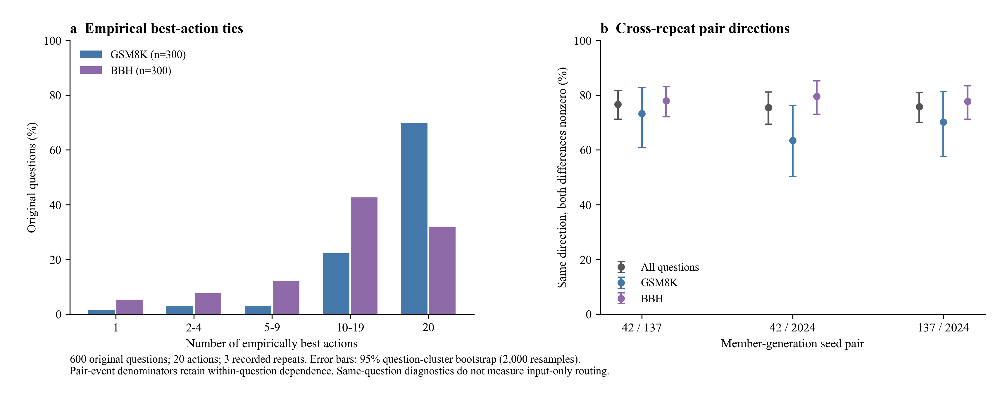

# E9 组合奖励可辨识性与跨生成重复诊断

## 研究问题与设置

使用已核查的原train600最终聚合评分，分析经验并列、真实记录内的组合分歧及跨生成重复方向。600道原题包含GSM8K和BBH各300道，BBH保留27个子任务。每题20组合×3生成重复始终作为同一个问题簇。

标准误差与区间只描述这批已反复用于开发的数据。2000次bootstrap在task内重采样原题，保留同题全部动作、生成重复和比较结果。三个seed编号不证明生成误差独立，137↔2024结果与其他seed对一并保留。

## 经验奖励分辨率

20组合三重复均值全平局的原题有306/600道。多个经验最优组合的原题有579/600道。

| 任务 | 原题数 | 多个经验最优 | 20组合经验均值全平局 |
|---|---:|---:|---:|
| gsm8k | 300 | 295 | 210 |
| bbh | 300 | 284 | 96 |

经验均值只能取0、1/3、2/3、1。最佳与次佳差为0包含多个经验最优；另报告最佳与严格次优动作的差，分母仅包含存在严格较低动作的原题。单题只有三次记录，无法据此区分真实期望并列与有限生成造成的经验并列。

## 跨生成非零差方向

以下分母是同题无序组合对在两个生成重复中都存在非零正确性差的事件数。该条件由已有奖励定义，只用于诊断。每个事件不构成新的独立原题。

| seed对 | 双方非零组合对事件 | 同向比例 | 题簇95%区间 |
|---|---:|---:|---:|
| 42 ↔ 137 | 4224 | 76.634% | [71.240, 81.641]% |
| 42 ↔ 2024 | 4407 | 75.494% | [69.378, 81.089]% |
| 137 ↔ 2024 | 4126 | 75.763% | [70.096, 80.984]% |

第一生成严格领先的动作还在第二生成中有多少收益，按第一生成差值方向翻转后计算，含第二生成平局，详细数值及题级区间见JSON。另两次生成同向且非零的组合对在第三次生成中的收益、反向与平局计数分别列出，未将同题筛选当作可部署规则。

## 同题两次选队、第三次评价

三轮轮流留出一个生成重复，候选只根据另两次同题奖励选定。并列按原语义动作列序选第一个，同时给出经验最优集合均匀选择的期望结果。

全20组合的跨重复选择准确率为88.3889%，均匀并列期望结果为88.2004%。

| 默认参照 | 默认准确率 | 跨重复选择差 | 题簇95%区间（百分点） |
|---|---:|---:|---:|
| global | 84.7778% | +3.6111pp | [+1.9444, +5.3889] |
| task | 85.9444% | +2.4444pp | [+0.8889, +4.1111] |
| subtask | 85.8333% | +2.5556pp | [+0.9444, +4.2778] |

这些结果利用同一道题部署前不可得的生成反馈，证据类型为hindsight/cross-repeat diagnostic。它们既不是仅凭题目输入的选队成绩，也不是真实总体能力的上界。三次经验均值的事后最大值单独记录，有限重复下更大的候选集合也不保证更高留出成绩。

## 合法训练区默认与配对差

Global、Task与Subtask默认均由该题所在原外折对应的history480评分计算。当前题的奖励不参与默认动作。三种默认的scores/actions先保存到私有冻结文件，再进入本诊断评价。Task/Subtask参照使用真实任务元数据，标明额外输入权限。

对每个默认和每个组合，报告D=组合正确性−默认正确性，取值−1、0、1。JSON逐项保存纠错、破坏、非零事件数、原题支持数、三重复平均配对差与题簇95%区间，另给条件于非零分歧的平均差。零分歧区域的条件均值记null。

## BBH子任务支持与经验平局

| 子任务 | 原题数 | 多个经验最优 | 20组合经验均值全平局 |
|---|---:|---:|---:|
| boolean_expressions | 11 | 11 | 7 |
| causal_judgement | 11 | 11 | 7 |
| date_understanding | 11 | 10 | 1 |
| disambiguation_qa | 11 | 11 | 2 |
| dyck_languages | 11 | 8 | 2 |
| formal_fallacies | 11 | 10 | 3 |
| geometric_shapes | 11 | 10 | 1 |
| hyperbaton | 12 | 12 | 4 |
| logical_deduction_five_objects | 11 | 11 | 6 |
| logical_deduction_seven_objects | 11 | 9 | 2 |
| logical_deduction_three_objects | 11 | 11 | 8 |
| movie_recommendation | 11 | 11 | 5 |
| multistep_arithmetic_two | 11 | 11 | 5 |
| navigate | 11 | 11 | 6 |
| object_counting | 11 | 10 | 6 |
| penguins_in_a_table | 11 | 11 | 4 |
| reasoning_about_colored_objects | 11 | 11 | 6 |
| ruin_names | 11 | 8 | 1 |
| salient_translation_error_detection | 11 | 9 | 2 |
| snarks | 12 | 11 | 1 |
| sports_understanding | 11 | 10 | 0 |
| temporal_sequences | 11 | 11 | 6 |
| tracking_shuffled_objects_five_objects | 11 | 11 | 1 |
| tracking_shuffled_objects_seven_objects | 11 | 11 | 0 |
| tracking_shuffled_objects_three_objects | 11 | 11 | 3 |
| web_of_lies | 11 | 11 | 3 |
| word_sorting | 12 | 12 | 4 |

子任务只有11—12道不同原题，所有子任务结果仅为支持量有限的描述性诊断，未进行子任务筛选或显著性主张。

## 输入内容对照与证据边界

100次任务/子任务内整题奖励块置乱由主训练runner单独执行。本脚本不拟合任何预测头，也不执行置乱。语义可预测性结论必须结合主报告里的原始训练与置乱训练对比，不能由本节同题跨重复结果替代。

**优势**为使用真实最终聚合评分、训练区默认以及保留同题相关性的区间，完整给出平局与非平局支持。

**风险**为仅三次生成、旧600题多次开发、原五折训练历史重叠及子任务样本少。区间条件于已冻结的历史默认和当前开发资产，未覆盖重新训练整个研究流程的不确定性。

## 下一步

将本诊断与预先冻结的PSMR/HSMR选队成绩和100次内容负对照共同解释。跨生成重复存在可观察机会，并不保证MiniLM题目内容可以预测这些机会。

