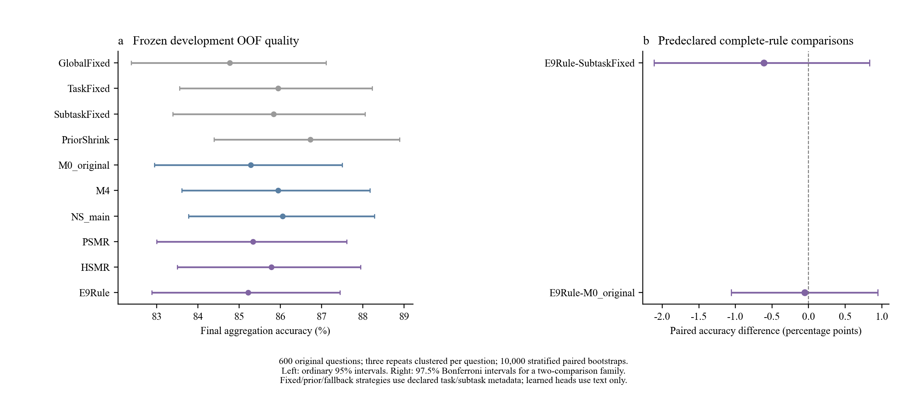

# E9 Bayes决策对齐、奖励可辨识性与保守组合路由

## 两项主比较与研究决策

- **E9Rule-SubtaskFixed** 为-0.6111个百分点，普通95%区间[-1.9444, +0.6667]，双比较家族区间[-2.1111, +0.8333]，Holm调整p=0.758124。
- **E9Rule-M0_original** 为-0.0556个百分点，普通95%区间[-0.9444, +0.8333]，双比较家族区间[-1.0556, +0.9444]，Holm调整p=0.949605。

**研究决策为 NO_GO_INPUT_ROUTER。**

这里评价的是完整内层选模及默认回退规则。PSMR和HSMR分别成绩保留为预定开发对照，全部结果来自既有600题的开发交叉验证。

## 实际实验设置

六个冻结模型，每题选择三个，共20个无序组合，V2聚合器与原评分器保持冻结。生成重复42、137、2024始终作为同题簇保留。
每个外折480题训练、120题评价，训练区内部沿用原三折。每个合法拟合区独立PCA16、原标准化及受罚常数，头为17×20共340参数。
PSMR采用20个独立sigmoid，内选BCE或Brier。HSMR使用整题LOO的global/task/subtask平滑先验，固定task/subtask伪计数10/3，收缩候选0/1/3/9。正则multiplier为0.1/1/10。未增加可选校准参数。
完整规则按内层真实未见题准确率选择PSMR或HSMR，严格优于内层子任务默认时启用，否则保留默认。平局优先HSMR，候选内并列优先更强正则。规则在外折评分前冻结。
固定策略、层级先验与完整规则的回退部分使用真实task/subtask metadata。两个学习头在部署时仅使用题目向量。metadata对照的权限在表中明确列示。

## 主实验表

| 方法 | 任务宏平均% | GSM8K% | BBH% | BBH子任务宏平均% | 经验选队损失 | 权限 |
|---|---:|---:|---:|---:|---:|---|
| PSMR | 85.3333 | 93.0000 | 77.6667 | 77.7497 | 0.098889 | text-only frozen MiniLM features |
| HSMR | 85.7778 | 93.3333 | 78.2222 | 78.3015 | 0.094444 | text-only deployment，training task/subtask label smoothing |
| GlobalFixed | 84.7778 | 92.7778 | 76.7778 | 76.8144 | 0.104444 | no query metadata，history-only global fixed action |
| TaskFixed | 85.9444 | 93.7778 | 78.1111 | 78.1706 | 0.092778 | query task metadata |
| SubtaskFixed | 85.8333 | 93.7778 | 77.8889 | 77.9929 | 0.093889 | query task and true BBH subtask metadata |
| PriorShrink | 86.7222 | 93.7778 | 79.6667 | 79.7886 | 0.085000 | query task and true BBH subtask metadata |
| E9Rule | 85.2222 | 92.6667 | 77.7778 | 77.8713 | 0.100000 | fold-frozen choice of text-only head or metadata-based SubtaskFixed fallback |
| M0_original | 85.2778 | 93.1111 | 77.4444 | 77.5159 | 0.099444 | text-only frozen MiniLM features, original fixed regularization |
| M0_tuned | 85.2778 | 93.1111 | 77.4444 | 77.5159 | 0.099444 | text-only frozen MiniLM features, historical nested-grid regularization |
| M4 | 85.9444 | 93.8889 | 78.0000 | 78.0303 | 0.092778 | text-only frozen MiniLM features, historical exact SPO+ |
| NS_main | 86.0556 | 94.0000 | 78.1111 | 78.1706 | 0.091667 | text-only frozen MiniLM features, historical NS-SPO+ delta=.05 |

经验选队损失以本题三生成平均奖励最大值为参照，其总体潜在期望仍有估计误差。

GlobalFixed遵循本轮冻结的先三生成平均、再题平均与精确argmax。数学并列值可能受浮点计算顺序影响，旧研究已记录84.9444%与当前84.7778%的默认点差。本轮保留已冻结选择，未在看到成绩后更换并列规则。

## 各生成方向、纠错和破坏

| 方法 | seed42% | seed137% | seed2024% | 相对M0纠错 | 破坏 | 净事件 |
|---|---:|---:|---:|---:|---:|---:|
| PSMR | 84.3333 | 85.8333 | 85.8333 | 10 | 9 | +1 |
| HSMR | 85.3333 | 86.5000 | 85.5000 | 20 | 11 | +9 |
| GlobalFixed | 84.1667 | 85.5000 | 84.6667 | 82 | 91 | -9 |
| TaskFixed | 85.1667 | 86.6667 | 86.0000 | 83 | 71 | +12 |
| SubtaskFixed | 84.8333 | 85.5000 | 87.1667 | 71 | 61 | +10 |
| PriorShrink | 86.1667 | 86.6667 | 87.3333 | 83 | 57 | +26 |
| E9Rule | 83.6667 | 86.5000 | 85.5000 | 23 | 24 | -1 |
| M0_original | 84.6667 | 85.3333 | 85.8333 | 0 | 0 | +0 |
| M0_tuned | 84.6667 | 85.3333 | 85.8333 | 0 | 0 | +0 |
| M4 | 85.3333 | 85.8333 | 86.6667 | 95 | 83 | +12 |
| NS_main | 85.5000 | 85.8333 | 86.8333 | 73 | 59 | +14 |

事件分母为600题×3个已记录生成，即1800。各外折和27个BBH子任务的题数与成绩完整保存在JSON。

## 内容负对照与机制

完成100个预先固定种子，每个合法inner/outer拟合区分别在GSM或BBH子任务内置乱整题3×20奖励块。对应模型执行相同内层网格与选模规则，特征预处理按相同合法输入缓存复用。

| 方法 | 原始训练% | 100次控制均值% | 控制范围% | 原始减均值pp | Monte Carlo p |
|---|---:|---:|---:|---:|---:|
| PSMR | 85.3333 | 86.0011 | 84.7222–87.0000 | -0.6678 | 0.930693 |
| HSMR | 85.7778 | 85.8744 | 85.0556–86.8333 | -0.0967 | 0.603960 |
| GlobalFixed | 84.7778 | 84.7778 | 84.7778–84.7778 | +0.0000 | 1.000000 |
| TaskFixed | 85.9444 | 85.9444 | 85.9444–85.9444 | -0.0000 | 1.000000 |
| SubtaskFixed | 85.8333 | 85.8333 | 85.8333–85.8333 | +0.0000 | 1.000000 |
| PriorShrink | 86.7222 | 86.7222 | 86.7222–86.7222 | +0.0000 | 1.000000 |
| E9Rule | 85.2222 | 85.6328 | 84.7778–86.3889 | -0.4106 | 0.891089 |

100次置乱属于训练机制控制，未增加独立题数。标准Monte Carlo p的最小分辨率为1/101，不能把重复置乱视为100个外部测试集。

PSMR与HSMR的原始训练成绩均低于各自100次控制均值。这一配置下，题目内容对应关系尚未显示超越训练组先验的选队收益。PriorShrink直接使用任务/子任务信息，其较高点值保留为组能力估计线索。
HSMR相对M0的正向点值是预定候选对照，完整规则按内层选出的跨折组合仍需按预定主结果报告。未根据外折成绩改选HSMR为正式获胜方案。

| 方法 | 原始均值MSE | 中心化MSE | 非零竞争差MAE | 非零配对排序准确率 | 最频繁动作题数 | 近并列题数≤1e-10 |
|---|---:|---:|---:|---:|---:|---:|
| M0_original | 0.080058 | 0.023473 | 0.425089 | 0.562441 | 55 | 0 |
| PSMR | 0.125267 | 0.023244 | 0.431841 | 0.560927 | 60 | 0 |
| HSMR | 0.200456 | 0.023086 | 0.432124 | 0.568458 | 63 | 0 |
| PriorShrink | 0.074538 | 0.023499 | 0.421741 | 0.580819 | 195 | 2 |
| E9Rule | 0.148575 | 0.023469 | 0.429126 | 0.554664 | 93 | 29 |

动作集中度、近并列、非零竞争差MAE与真实Brier保存在逐方法score_diagnostics。竞争组合由原M0冻结Top3相关配对定义，非零子集按本题经验奖励差确定，仅用于诊断。
M4/NS输出为未校准分数。其原始数值误差与PSMR概率Brier具有不同含义。独立Bernoulli输出允许多个动作同时正确。

数学检查确认平方损失总体最优为条件均值，真实实现后regret的总体目标同样保持均值排序。有限线性类、正则、噪声与SPO替代风险分别分析，未将它们混为MSE总体不一致。
历史M4的全平局赢家约定可引入动作编号方向。新候选无赢家索引监督，软件同步重命名测试通过。数学反例和软件PASS各自只支持相应命题。

跨生成稳定性与奖励可辨识性详见02_signal_report.md。两seed选队、第三seed评价是使用同题反馈的hindsight诊断。

## 完整成本与复现

实际完成28280个新预测头拟合，主实验280个，100次内容控制28000个。18个资源预检头全部复用于主实验。另执行20次合法PCA/Scaler拟合并在控制中复用。
正式训练编排wall为186.759秒，worker路径CPU合计169.688秒。每worker最大记录峰值RSS为146.94MiB。
组件耗时与并行总wall分别保留，逐候选目标、梯度、收敛、内层分数及失败状态均在私有日志。全部新优化器成功，较差候选和种子完整保留。
首次合成测试开发中曾修正期望数组形状断言，预测模型未因此改变，该次单独进程耗时未保留。正式源锁前后两次20项资格执行均通过，正式头拟合失败数为0。
成本汇总首次逐小文件扫描受I/O限制，记录10.703125秒CPU和190.803119秒wall后，改读同一批诊断的冻结聚合日志。该次后处理保留在成本账本，模型和统计均未重跑。
新增LLM/API、成员生成、聚合、gold和向量提取均为0。共同历史投入为600 gold、10800成员调用和36000聚合调用。各策略服务Token按真实缓存中的所选三成员与聚合器分账，未把训练缓存采购费用当成免费服务。
实际命令、依赖及私有输入清单见[复现说明](D:/develop/CV/多臂老虎机/experiments/e9_bayes_gate/README.md)。数据hash与相对来源路径见00_asset_manifest.json。原协议和必要PASS状态加强修订均保留为不可覆盖文件。

## 统计与证据等级

10000次bootstrap按outerfold×task重采样原题，各方法与同题三生成一起重采样。普通95%区间逐比较报告，主族另报Bonferroni97.5%区间与Holm调整p。后者与普通区间区分标注。
五折训练历史重叠，区间条件于已拟合模型。旧600题已多轮开发，bootstrap不包含整个训练过程重复不确定性。当前证据等级为数学构造、软件资格和开发OOF。未来独立泛化尚待单独设计。

## 优势与风险

**优势**是恢复历史冻结参照，两个新方向保持相同输入维数和预测头容量，所有选参在合法内层完成，100次内容控制保留任务先验与题内相关结构。
**风险**是每题仅三次已有生成，BBH每子任务训练支持有限。层级伪计数与有限正则网格为固定实现选择，Sigmoid-Brier具有非凸性。metadata默认与text-only头的输入权限不同，需要明确区分。
当前工作目录没有本地Git checkout，本轮按任务书仅保存本地新增文件，Git分支未创建。来源SHA引用已保存的E12远端回执，未在本轮重新联网确认。

## 决策与唯一下一优先任务

未满足条件为 primary_positive_family_ci, primary_holm_pass, seed_consistency, task_guard, content_guard。
优先推进低预算任务/子任务组能力估计，在固定反馈掩码下研究同一监督的利用效率，并与已有SaveRouter收缩基线做同权限对照。此处仅给下一阶段选择，不新增实验。

## 给导师的摘要

本轮在既有600道题上完成独立Bernoulli奖励预测与层级收缩监督的嵌套开发验证，保持六模型、三成员组合、原MiniLM表示和340参数头。完整规则相对子任务默认和原Ridge分别为-0.6111、-0.0556个百分点，研究决策为NO_GO_INPUT_ROUTER。历史参照均恢复，并完成100次整题内容负对照。数学核查区分了条件均值目标、替代风险和并列编号偏好。全部负向候选保留，结果限于重复开发资产，保留题与新模型调用均未使用。需要请教的关键选择是，是否将固定反馈下的低预算组能力估计作为下一主线，再依据独立协议讨论部分动作反馈。
